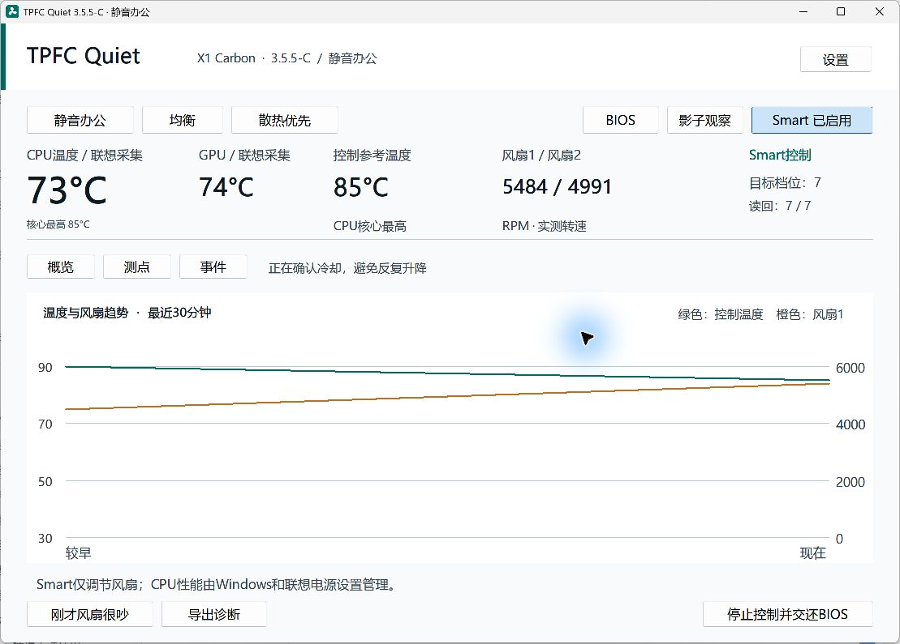

# TPFC Quiet

   

Experimental native Windows fan control for a ThinkPad X1 Carbon Gen 14, developed around quiet office work and explainable control decisions.



The screenshot shows a real machine cooling after a build. The current UI is Chinese. It is not a noise benchmark.

## 中文简介

TPFC Quiet 是为 **ThinkPad X1 Carbon Gen 14（2026，Intel Core Ultra 7 356H）** 开发的原生 Windows 风扇控制程序（C++17，服务 + 托盘界面），目标是安静办公与「每一次调速都能解释」。

- 三档策略：安静办公 / 均衡 / 散热优先，均带滤波、回差与确认期；临界温度绕过平滑直接介入。
- 四种模式：BIOS 接管、Shadow（只建议不接管）、Smart 智能控制、限时手动。
- 双风扇转速与控制回读；传感器/写入故障时先留存故障快照再交还 BIOS，符合条件时有界自动恢复。
- 依赖本机已有的 TVicPort 与联想温度组件（**不随仓库分发**，版本见英文说明）；目前仅在上述一台实机验证，未做通用机型兼容认证。
- 构建：Visual Studio 2022 C++ 工具链 + Python 3，在 x86 Native Tools 命令行运行 `python tools/build.py`（构建自带 367 项软件检查）。
- 许可证：Unlicense（公有领域）。本项目与联想无关。

English details follow below.

## Current scope

Version **3.5.5** has been built and locally installed on one X1 Carbon Gen 14 with an Intel Core Ultra 7 356H. This source package is prepared for a future public repository. It is not a general compatibility certification for ThinkPads.

The program requires an existing compatible TVicPort installation and tested Lenovo temperature components. It does not bundle or install their binaries. Lenovo integration currently pins VantageService **5.1.2609.9** and HardwareScanAddin **4.12.26070.12**. A component update can require adapter work.

## Features

- Separate displayed CPU temperature, hottest CPU core, GPU temperature, and control reference. Unverified EC locations retain register-address labels.
- Quiet Office, Balanced, and Cooling Priority profiles, with filtering, hysteresis, and confirmation periods. Critical heat bypasses ordinary smoothing.
- BIOS, Shadow, Smart, and temperature-limited timed manual modes. Shadow makes suggestions while BIOS controls the fans.
- Dual-fan RPM and control readback, a service engine, and a tray client whose window can close while control continues.
- Bounded read-only confirmation for isolated control mismatches, immediate handoff for firmware/high-bit indications, and bounded recovery for eligible sensor/write faults.
- Failure snapshots captured before BIOS handoff overwrites the requested levels. Diagnostic exports remain local.

CPU frequency limiting has been removed. `power.hpp` remains for restoring journals left by an earlier experimental version; it does not enable a CPU-limiting mode in production. The controlled minimum on the tested machine is fan level 1. Fan-stop operation is not certified.

## Build and software checks

Install Visual Studio 2022 C++ build tools, the Windows SDK, and Python 3. Open an **x86 Native Tools Command Prompt**, then run:

```text
python tools/build.py
```

Alternatively, pass `--toolchain <directory>` for an existing portable MSVC/Windows SDK tree. The repository does not download or redistribute Microsoft tools. The icon is included; rebuilding it separately with `tools/make_icon.py` requires Pillow.

The build runs 367 software checks and creates three x86 editions under `releases/3.5.5/`. Python is a build/diagnostic dependency, not an application runtime dependency.

| Edition | Purpose |
| --- | --- |
| A | Information and original-curve comparison |
| B | Smart policy comparison |
| C | Daily service and tray application |

These are three editions, not three independently validated hardware platforms. The software tests use simulated samples and fake port functions; they do not demonstrate acoustic performance or hardware compatibility.

## First use

Use the C edition for service installation. Installation requires administrator rights:

```text
TPFCQuiet.exe --install
```

The canonical executable is `%ProgramFiles(x86)%\TPFCQuiet\TPFCQuiet.exe`. Start the installed application from the Start menu. A new machine remains under BIOS control until its verification requirements are satisfied. Do not copy another machine's verified configuration or run a second EC fan controller alongside it.

For an interface-only preview, without accessing fan hardware:

```text
TPFCQuiet.exe --demo
```

Status can be read from the installed service without enabling control:

```text
TPFCQuiet.exe --status --output status.json
```

The UI offers BIOS handoff. Service removal is available with `--uninstall`; local configuration and diagnostics are retained.

## Recovery and limitations

Eligible Smart sensor/write faults first hand control to BIOS. Automatic recovery requires valid fresh protection data, confirmed BIOS readback, valid RPM, and 30 seconds of safe stability with protection temperatures no higher than 80°C. The rolling hourly budget permits at most three attempts, including at most one write-fault recovery. Sleep or an explicit mode change cancels pending fault recovery.

Persistent control mismatches, firmware takeover, fan-response faults, and critical protection failures can keep BIOS in charge. The application does not guarantee that Smart will remain enabled under every workload or firmware condition. Its user-space mutex does not establish exclusive ownership over firmware or all other drivers.

Local logs normally reside under `%ProgramData%\TPFCQuiet`. Review exports before sharing them. Do not commit `profile.ini`, `owner.sid`, raw logs, or machine-specific certification data.

See [development notes](docs/development-notes.md), [verification scope](docs/VERIFICATION.md), [contributing](CONTRIBUTING.md), and [credits](CREDITS.md).

## License

The included source follows the existing project's [Unlicense](LICENSE). Third-party drivers, Lenovo components, and Microsoft tools have their own terms and are not included. ThinkPad and Lenovo names identify the tested platform; this project is independent of Lenovo.
