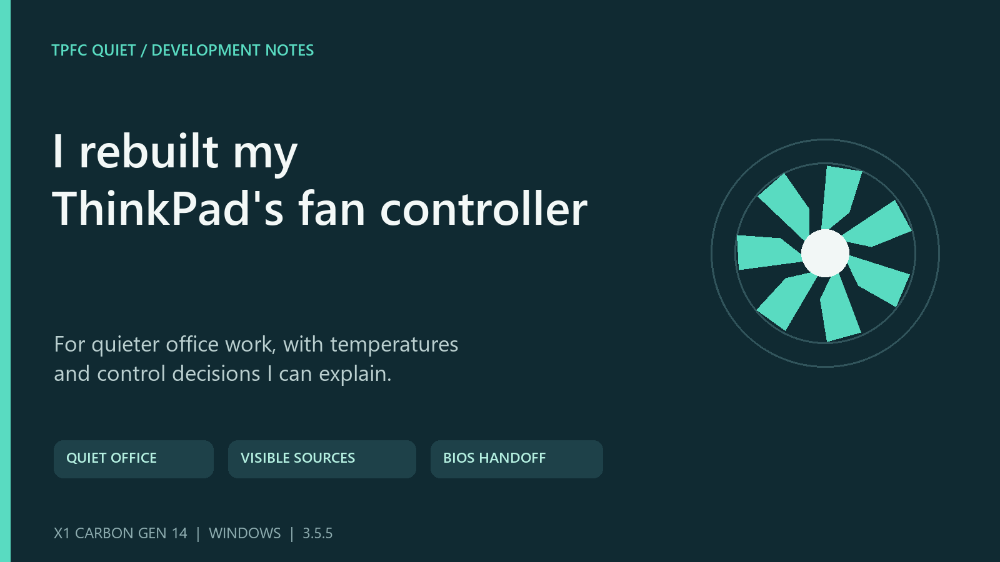
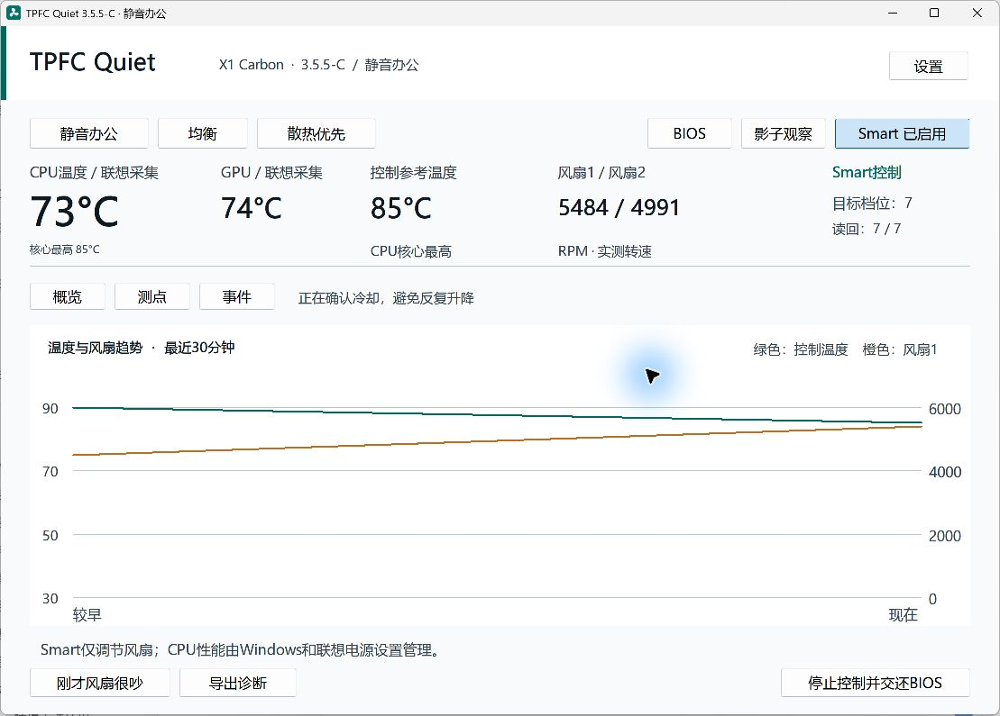
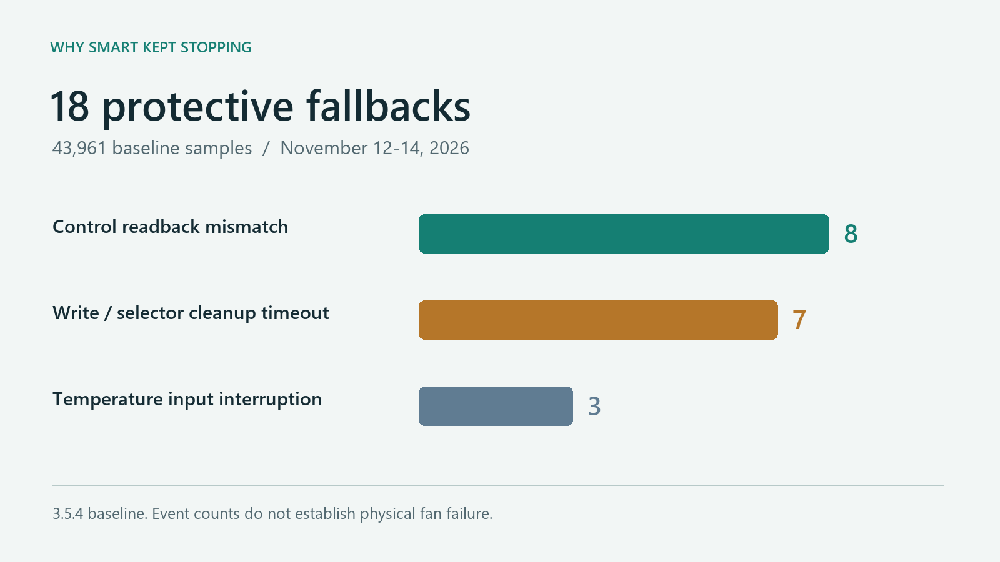
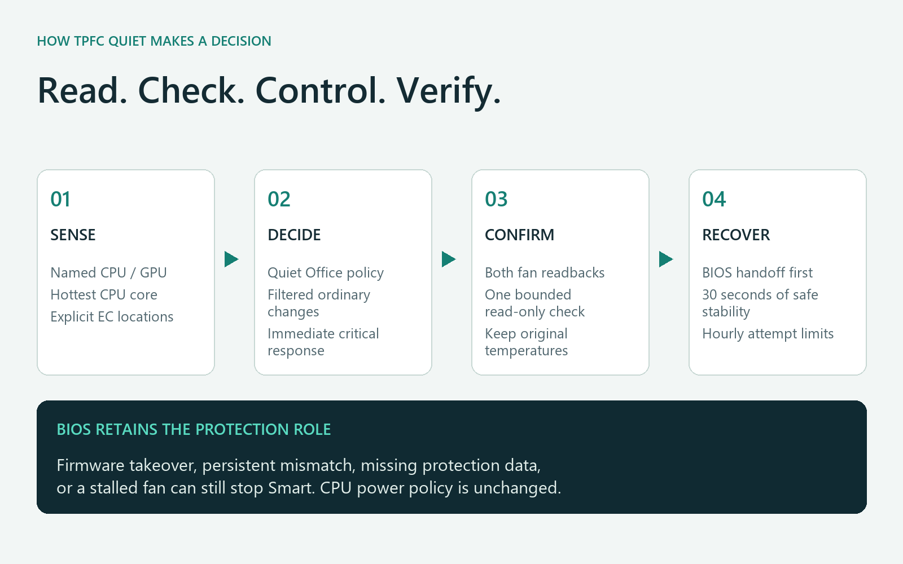

# I rebuilt my ThinkPad's fan controller for quieter office work

*Building TPFC Quiet with Codex, one unexplained fan surge at a time.*

I wanted my 2026 ThinkPad X1 Carbon to be less distracting while I worked. I was already using TPFanControl, but two things bothered me: I could not tell what the tray temperature measured, and the fans sometimes got loud without an obvious explanation.

That led to TPFC Quiet, a native Windows application I developed with Codex. We used TPFanCtrl2's EC conventions as a starting point and built a new interface, control engine, and diagnostic workflow around this particular laptop.

The current local build is 3.5.5. Quiet Office is the profile I care about most. The project is still experimental, and this is an account of what we built and verified so far.

## First, make the temperature mean something

A number such as 67°C is hard to use when its source is unclear. Older ThinkPad tools show short EC labels such as `pwr` and `pci`. We could read those registers, but we did not have evidence that those old names described the same physical locations on my new X1 Carbon.

We kept unverified readings labeled by their EC address. For named CPU and GPU temperatures, TPFC Quiet uses the installed Lenovo sensor components. The service can start the tested temperature producer itself, so I do not have to open Vantage's temperature page every time.

The panel separates the displayed CPU temperature from the temperature used to protect the machine. The latter can be the hottest CPU core, the GPU, or an enabled EC reading. It also shows both fans' measured RPM, the requested level, and the levels read back from the controller.

*Actual Chinese-language interface on my laptop, captured during cooling after a build. The fans were running fast in this screenshot; it is a status example, not evidence of quiet operation.*

That distinction matters. In this capture, the CPU headline reads 73°C while the hottest core is 85°C. A fan decision based only on the headline would miss relevant heat.

## Quiet Office needs a sense of time

We added filtering, separate thresholds for increasing and decreasing fan speed, and confirmation periods. This reduces the tendency to change levels whenever a temperature moves briefly across a threshold. A critical temperature still triggers the high fan level immediately.

There are three profiles: Quiet Office, Balanced, and Cooling Priority. Shadow mode lets me observe the proposed level while BIOS keeps control. Timed manual control has temperature and duration limits.

On this machine, the controlled minimum is level 1. We have not certified fan-stop operation. Quiet Office also leaves CPU frequency and Windows power policy alone. We tried a separate CPU-limiting feature during development, encountered conflicts with platform power management, and removed it at my request.

## The difficult bug was staying in Smart

The first recovery implementation worked in a real incident on November 12. The service handed control to BIOS at 13:34:21. Once the required safe conditions remained stable, it resumed Smart at 13:38:51 without a manual click.

But everyday use exposed more interruptions. For the next investigation, we examined 43,961 telemetry rows covering November 12 at 13:31 through November 14 at 06:29, local time. The failure journal contained 18 protective fallbacks: eight control-readback mismatches, seven write or cleanup timeouts, and three temperature-input interruptions. Two additional Smart exits in that window were normal sleep transitions.

*Counts from the 3.5.4 baseline. These are software protection events, not a diagnosis of broken fans.*

The old running-state check treated a single mismatched byte as a reason to stop Smart and require manual intervention. We saw pairs such as `2 / 0`, as well as values outside the normal requested levels. Those records alone could not tell us whether each event was a transient read problem or a lasting change in control.

The write journal exposed another detail. In three of the seven write-related incidents, both fans had already read back the requested level. The final fan-selector cleanup then timed out. A generic "write failed" message had hidden that difference.

We also found that one failed Lenovo temperature query immediately replaced the last valid packet, even when that packet was still inside the existing freshness limit.

## What changed in 3.5.5

For an isolated low-bit readback mismatch, the backend now makes one bounded, read-only confirmation of both fan levels. If both match the requested level, Smart can continue. It preserves the temperatures from the original sample, so a hot reading is not replaced by a cooler retry.

Firmware/high-bit indications bypass that confirmation path. Persistent mismatches still hand control to BIOS. We have not added a loop that repeatedly writes against firmware takeover.

For writes, we reserve time inside the existing transaction budget for selector cleanup and record the first timed-out operation and EC status. A failed temperature query can retain the previous valid packet until its original expiry. We do not reset its timestamp or extend the 12-second freshness limit.

The earlier bounded recovery remains: eligible sensor or write faults first return control to BIOS, then require fresh inputs and 30 seconds of safe stability at no more than 80°C. Recovery has an hourly attempt budget. Persistent readback mismatches and other hard protection events still require attention.

The interface reflects the actual state: Smart enabled, BIOS in control, or Smart waiting to recover. Minimizing or closing the panel to the tray leaves the service in charge.

## What we can claim today

The existing 358 checks passed, along with nine focused checks for the new readback and freshness behavior. The same focused regression suite fails two checks against the old implementation and passes all nine against 3.5.5. We also built all three editions, checked their native windows, installed the C edition, and verified Smart while minimizing and closing the panel to the tray.

The changes make the program easier to inspect and address reproducible causes of unnecessary interruption. We have not yet measured a long-term reduction in fallback frequency, a noise reduction in decibels, or a performance gain. The new real-device observation window is short. I want those measurements before making stronger claims.

## Preparing to share the code

I plan to publish the source on GitHub after this next period of real use. We have prepared a separate source package with build instructions, tests, and upstream attribution. It excludes my machine configuration, private logs, Microsoft build tools, and third-party driver or Lenovo binaries.

This build has been exercised on my X1 Carbon Gen 14 with a Core Ultra 7 356H. The Lenovo integration is pinned to component versions tested here. Another ThinkPad needs its own compatibility checks and fan-level verification before enabling control.

I started with a request for quieter office work. The development has made me care just as much about seeing why the fans changed speed, knowing who currently controls them, and having a useful record when something goes wrong.

If you work on ThinkPad fan control, I'd be interested in how you verify EC readbacks and handle firmware takeover.

---

Technical background: [TPFanCtrl2 upstream](https://github.com/Shuzhengz/TPFanCtrl2) and the [ACPI embedded-controller interface specification](https://uefi.org/specs/ACPI/6.6/12_Embedded_Controller_Interface_Specification.html). Runtime counts and test results above come from this project's local evidence. Source publication is planned; no public repository has been announced yet.
